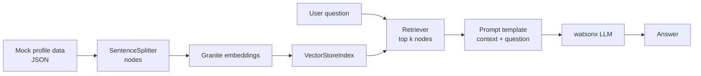

# LinkedIn Icebreaker Bot

A Retrieval Augmented Generation (RAG) app that reads a LinkedIn profile, suggests three interesting facts to start a conversation with, and answers follow up questions about the person's career and education.

Built with **LlamaIndex**, **IBM watsonx.ai** (Granite embeddings plus Granite and Mistral LLMs), and **Gradio**.

## What it does

1. Loads a LinkedIn profile (mock JSON data)
2. Splits the profile into chunks and embeds them with IBM Granite
3. Stores the embeddings in a LlamaIndex vector index
4. Generates three icebreaker facts about the person
5. Lets you chat with the profile, answering only from the retrieved context (and saying "I don't know" when the answer isn't there)

You can use it from the terminal or through a web interface.

> **Note:** the app currently runs on **mock data**: a sample public LinkedIn profile stored as JSON and provided by the IBM lab. It does not fetch live data from LinkedIn. The ProxyCurl API that the original lab used for live profiles has been discontinued.

## How it works



| RAG step | Where it happens |
|---|---|
| Load | `modules/data_extraction.py` |
| Split and index | `modules/data_processing.py` |
| Embedding model and LLM setup | `modules/llm_interface.py` |
| Retrieve, augment, generate | `modules/query_engine.py` |
| Terminal app | `main.py` |
| Web app (Gradio) | `app.py` |
| Settings and prompt templates | `config.py` |

## Tech stack

* Python 3.11
* LlamaIndex (`Document`, `SentenceSplitter`, `VectorStoreIndex`, query engines, custom prompt templates)
* IBM watsonx.ai: `granite-embedding-278m-multilingual` for embeddings; `granite-4-h-small` and `mistral-small-3-1` for generation
* Gradio (`gr.Blocks`, tabs, chatbot component)

## Getting started

```bash
git clone https://github.com/sabasgh/linkedin-icebreaker-bot.git
cd linkedin-icebreaker-bot
python3.11 -m venv venv
source venv/bin/activate
pip install -r requirements.txt
```

**Credentials:** the project was built in the IBM Skills Network lab, which provides watsonx access. To run it elsewhere, you need your own IBM watsonx.ai account: set the `WATSONX_APIKEY` environment variable and update `WATSONX_URL` and `WATSONX_PROJECT_ID` in `config.py`.

### Terminal version

```bash
python main.py --mock    # use the mock profile
python main.py --mock --model mistralai/mistral-small-3-1-24b-instruct-2503
```

Type `exit` to quit the chat.

### Web version

```bash
python app.py
```

Open `http://localhost:7860`, keep **Use Mock Data** checked, click **Process Profile**, then ask questions in the **Chat** tab.

## What I changed from the original lab

This started as a guided project in the IBM RAG and Agentic AI Professional Certificate. Along the way I:

* **Updated the model list** after the original models were deprecated or blocked in the environment (`llama-3-2-11b-vision`, `mistral-medium`), switching to models that are currently supported
* **Improved error logging** so failed queries print a full traceback instead of a one line message
* **Debugged and repaired** module code that broke during setup (merged lines, missing `__name__`, indentation errors)

## Ideas for next steps

* Load real profiles from a LinkedIn "Save to PDF" export, since the ProxyCurl API the lab used has been discontinued
* Index the profile once and reuse it, instead of retrieving twice per question
* Raise `truncate_input_tokens` above 3 so embeddings use more of each chunk
* Move from the deprecated `/text/generation` endpoint to watsonx's `/text/chat` API
* Add expiry for chat sessions so memory doesn't grow forever

## Credits

Based on a project from the [IBM RAG and Agentic AI Professional Certificate](https://www.coursera.org/professional-certificates/ibm-rag-and-agentic-ai) on Coursera, extended and maintained by [Saba Soghrati](https://github.com/sabasgh).
